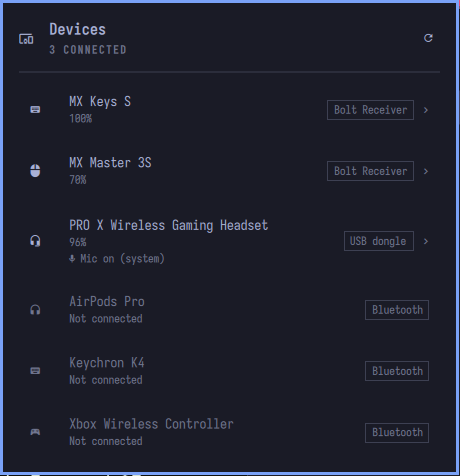

# Devices — an Omarchy bar plugin

Battery levels and settings for every wireless device on your desk, in one
panel, however it is connected. Each device is labelled with how it reaches
the computer: **Bolt Receiver** / **Unifying Receiver**, **USB dongle** or
**Bluetooth**.

- **Logitech Bolt / Unifying receivers** — battery, plus DPI, SmartShift,
  ratchet/free-spin, scroll direction, high-resolution scrolling, keyboard
  backlight, Fn-key swap and OS layout (whatever the device supports)
- **USB headset dongles** (Logitech G PRO X and anything else
  [HeadsetControl](https://github.com/Sapd/HeadsetControl) supports) — battery,
  sidetone, auto power-off, and whether the microphone is muted
- **Bluetooth** — paired controllers, earbuds and keyboards with their
  connection state and battery, when the device reports it. Connecting,
  pairing and the Bluetooth switch stay in Omarchy's Bluetooth widget.

The bar shows a single icon. When any device drops to the warning level
(20% by default) it turns the urgent colour and gains a battery-alert mark,
the tooltip names the devices that are low, and a notification appears once
per device. It repeats only after that device has charged or recovered.



## Requirements

- Omarchy with the plugin-capable shell (`omarchy-shell`)
- `solaar` — Logitech receivers. Only its Python library and udev rules are
  used; the Solaar app does not need to run.
- `headsetcontrol` — USB headsets

```bash
sudo pacman -S solaar headsetcontrol
```

Unplug and replug the receiver and headset dongle once afterwards so their
udev permission rules apply.

## Install

```bash
omarchy plugin add https://github.com/januszmajek/omarchy-devices --enable
```

Move it on the bar with `omarchy bar move januszmajek.devices --section right`.

## Use

- **Click** the bar icon to open the panel, **right-click** to refresh.
- **Click a receiver or dongle device** to show its settings. Changes apply
  immediately.

### Headset microphone

For an online USB headset the panel shows whether its microphone is muted in
the system (PipeWire). Click the mic line to mute or unmute it.

On the Logitech PRO X Wireless (`046d:0aba`) the mute button works inside
the headset. The headset's USB audio mute control follows the button, but
the headset never tells the computer when it changes, so the system keeps
showing the state it read last. The panel marks such headsets with "button
not reported"; the red mark on the button shows whether the button has muted
the mic. Muting from the system also seems to act on the headset (it plays
its mute sound), but whether both share one switch has not been fully
verified.

Reading the mute control directly works, but only with the audio driver
detached, which cuts the headset's sound, so the plugin does not do it.

### Saved settings

Settings you change are saved to
`~/.local/state/omarchy-devices/settings.json` and written again whenever the
device wakes up or reconnects, because many Logitech devices and headsets
forget them when they power off.

Not shown on purpose: button diversion and wheel diversion (they hand the
buttons to Solaar's rule engine, so without the Solaar app running they stop
working) and host switching (one click would send the device to another
computer). Use the Solaar app for those.

## Settings

Inline on the widget's entry in `~/.config/omarchy/shell.json`:

| Key | Default | Meaning |
| --- | --- | --- |
| `lowBattery` | `20` | At or below this percentage the bar warns and a notification is sent |

## How it works

`Service.qml` runs one long-lived `scripts/devices-helper.py` for all
monitors. The helper uses Solaar's `logitech_receiver` library and
`headsetcontrol`, prints a JSON state line on every change or every 30
seconds, and takes JSON commands on stdin. `Panel.qml` is the bar widget and
popup. Bluetooth devices and the headset's PipeWire microphone come straight
from Quickshell's BlueZ and PipeWire bindings in the service, which also sends
the low-battery notifications so they fire once, not once per monitor.

Run the helper on its own to see what it sees:

```bash
python3 scripts/devices-helper.py   # type {"cmd":"refresh"} and Enter; Ctrl-D quits
```

## License

MIT
